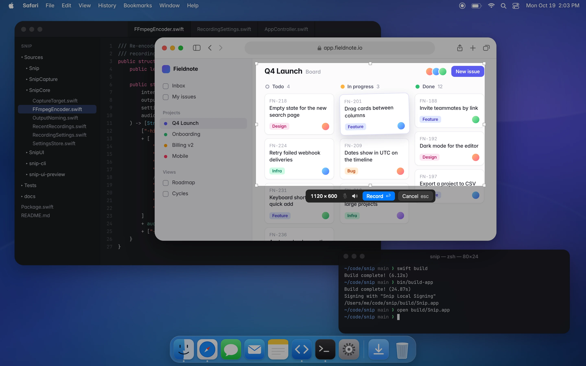
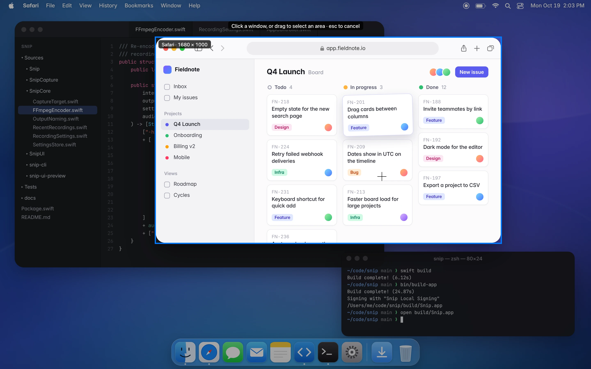
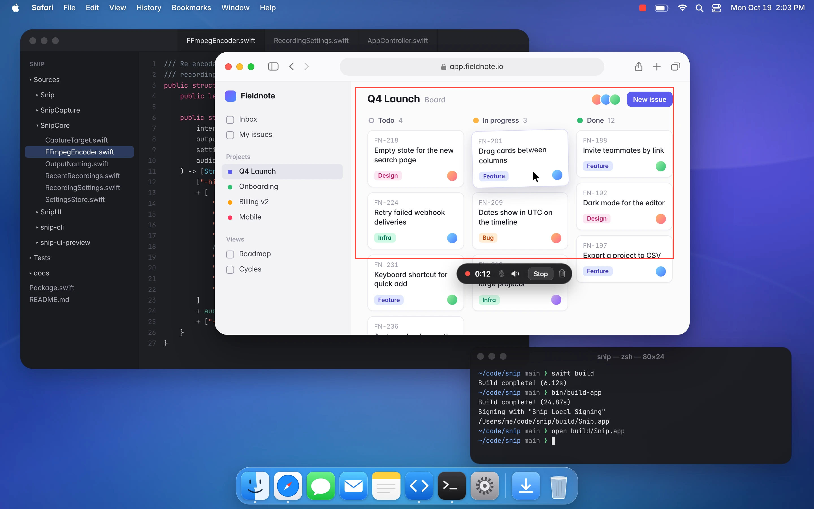
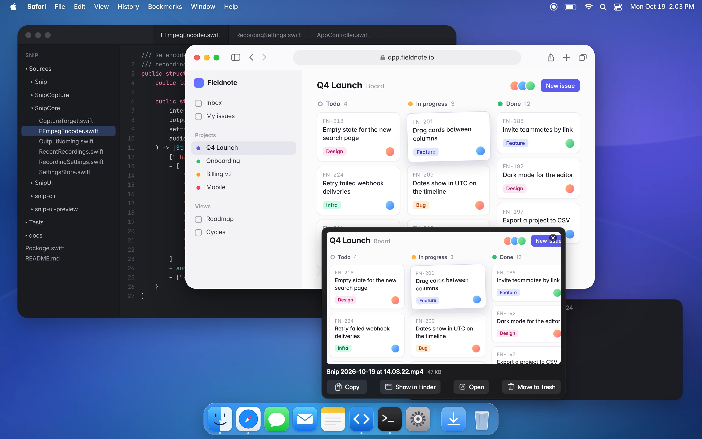
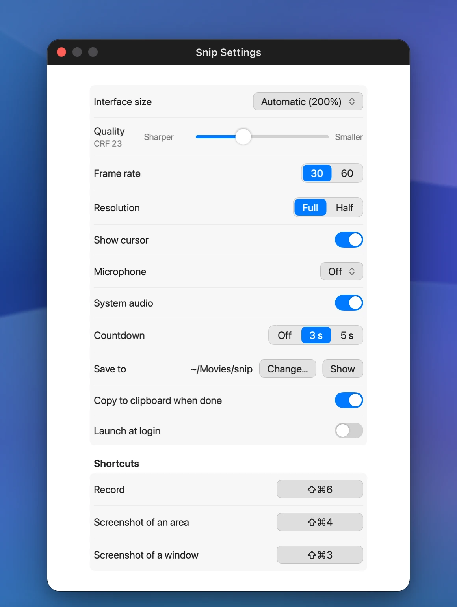

# Snip

A small macOS menu bar app for recording short screen clips. Press **⇧⌘6**, click a window or drag
a box, and when you stop, a small MP4 is in `~/Movies/snip` and on your clipboard.



## Why it exists

I record a lot of short clips: a bug to report, a change to show in a pull request, a quick
answer in Slack. OBS was more setup than a 20-second clip deserves, and I didn't want an account
or an upload for something that should stay a file on my Mac. So I wrote the tool I wanted, and
I'm sharing it in case it suits you too. It's a personal project: it does what I need, and not
much more.

What it does:

- Records a window, a box or a whole display, with system audio and optionally the microphone.
  Both can be switched on and off while recording.
- Keeps everything local. There's no account, and nothing is uploaded.
- Makes small files. Capture is hardware encoded, so recording barely uses the CPU; when you stop,
  ffmpeg re-encodes with x264 at a constant rate factor (CRF 23 by default). For screen content
  that is usually several times smaller than the hardware encode.
- Puts the file on the clipboard when it's done, ready to paste into a chat, an email or a GitHub
  comment.
- Comes with `snip-cli`, which records from the command line with the same code.

## Using it

**1. Pick what to record.** Press ⇧⌘6 (or click the menu bar icon, then **New Recording**). The
screen dims. The window under the pointer lights up with its name and its size in pixels; click
it to choose that window. Or drag a box anywhere: hold Space while dragging to move it, and drag
its handles afterwards to adjust it (hold Shift to keep its proportions). Press Space without
dragging to pick the whole display.



**2. Record.** Press Return or click **Record**. The microphone and speaker buttons in the bar
turn the microphone and system audio on or off for this recording. A 3-2-1 countdown follows
(Escape cancels it), then Snip records.

**3. While recording,** a thin red outline marks the area (it stays out of the recording) and a
pill under it shows the time. The pill's microphone and speaker buttons switch audio on and off
mid-recording; the trash can discards the recording. The menu bar icon becomes a red stop
button.



**4. Stop** with ⇧⌘6, the pill's **Stop** or the menu bar icon. The pill shows the compression
progress, then the file lands in `~/Movies/snip` as `Snip 2026-10-19 at 14.03.22.mp4` and is
copied to the clipboard.

**5. After recording,** a panel appears where the pill was. Click the video to play it, drag it
into another app, or use **Copy**, **Show in Finder**, **Open** or **Move to Trash**. × or Escape
closes the panel; the file stays.



### Shortcuts

| Key | When | What it does |
| --- | --- | --- |
| ⇧⌘6 | any time | Start a recording, or stop the one in progress (change it in Settings) |
| Click | choosing | Choose the highlighted window |
| Drag | choosing | Draw a box |
| Space, held | dragging a box | Move the box instead of resizing it |
| Shift, held | resizing a box | Keep the box's proportions |
| Space | choosing | Toggle the whole display |
| Right-click | box drawn | Go back to picking a window |
| Return | box or window chosen | Record |
| Escape | choosing, countdown | Cancel |

### Menu bar

The menu has **New Recording**, **Record Last Area** (the same window or box as last time, no
selection step), **Microphone** and **System Audio** toggles, your recent recordings (choose one
to show it in Finder), **Settings…** and **Quit Snip**.

### Settings



- **Interface size**: 100% to 250%, for Snip's own overlay, bar, pill and panels. Automatic picks
  200% on a 1x display wider than 5000 points (an 8K-wide monitor) and 100% elsewhere.
- **Quality**: the x264 CRF, 18 (sharper, larger) to 32 (smaller). 23 is x264's default.
- **Frame rate**: 30 or 60. **Resolution**: Full records native pixels (2x on Retina); Half
  records at 1x, a quarter of the pixels.
- **Show cursor**, **Microphone** (Off or an input device), **System audio**, **Countdown** (off,
  3 or 5 seconds), **Save to** (default `~/Movies/snip`), **Copy to clipboard when done**,
  **Shortcut**, **Launch at login**.

## Getting it running

There's no download; you build it from source. It takes a few minutes.

### Requirements

- macOS 15 (Sequoia) or later.
- Xcode 16 or later, or the Swift 6 toolchain from the Command Line Tools
  (`xcode-select --install`), for `swift build`.
- [Homebrew](https://brew.sh) ffmpeg for the small files: `brew install ffmpeg`. Snip finds it in
  `/opt/homebrew/bin` or `/usr/local/bin`, even when launched from Finder. Without it, Snip still
  records but keeps the larger uncompressed file.

### Build and install

```sh
git clone https://github.com/brennancheung/snip.git
cd snip
swift build                 # the app, snip-cli and snip-ui-preview
swift test
bin/make-signing-cert       # once: a local code-signing certificate (see Signing)
bin/build-app               # build/Snip.app, signed
cp -R build/Snip.app ~/Applications/
open ~/Applications/Snip.app
```

Snip has no Dock icon; look for the record icon in the menu bar.

### Permissions

- **Screen & System Audio Recording.** On first launch Snip asks for it. Turn on Snip in System
  Settings › Privacy & Security › Screen & System Audio Recording, then quit Snip and open it
  again (macOS applies the permission to a fresh launch). This one permission covers system
  audio too.
- **Microphone.** Asked the first time you turn the microphone on.
- Snip doesn't need notifications, accessibility or any other permission.

### Signing

macOS ties Screen Recording permission to the app's code signature. An ad-hoc signed app (what you
get with no certificate) looks like a new app after every rebuild, so macOS asks for permission
again each time.

`bin/make-signing-cert` creates a self-signed code-signing certificate called "Snip Local
Signing" in your login keychain, and `bin/build-app` uses it automatically from then on, so the
permission survives rebuilds. It needs no Apple Developer account. macOS may ask for your login
keychain password while it imports the certificate. Afterwards
`security find-identity -p codesigning` lists it as `CSSMERR_TP_NOT_TRUSTED`; that is expected
for a self-signed certificate and doesn't matter for builds you run yourself.

`bin/build-app` picks its identity in this order and prints which one it used:

1. `SNIP_SIGN_IDENTITY`, if set (for example your own "Developer ID Application: …" or "Apple
   Development: …" identity).
2. "Snip Local Signing", if it is in the keychain.
3. Ad hoc.

### Troubleshooting

- **Snip asks for Screen Recording permission although it's turned on.** The permission belongs to
  an older signature (an ad-hoc build, or a build from before you made the certificate). Reset it,
  then open Snip again and allow it once more:
  ```sh
  tccutil reset ScreenCapture com.brennancheung.snip
  ```
- **The recording has no sound.** System audio needs the Screen & System Audio Recording
  permission and the speaker toggle on (in the bar, the pill, the menu or Settings). The
  microphone needs the Microphone permission and an input picked in Settings, or the default one.
- **The recording is a large `.mov`.** ffmpeg wasn't found, or it failed; the after-recording
  panel says which. Install it with `brew install ffmpeg`. The `.mov` is the uncompressed
  recording without the microphone track.
- **⇧⌘6 does nothing.** Another app may own the shortcut. Pick a different one in Settings ›
  Shortcut.

## snip-cli

`snip-cli` drives the same capture and encode code without the UI, for scripts and for testing.
Build it with `swift build` and run it from `.build/debug/snip-cli`. The terminal that runs it
needs Screen & System Audio Recording permission.

```sh
snip-cli windows                                 # recordable windows: id, app, title, size
snip-cli displays                                # displays: id, size in points, pixel scale
snip-cli record --window 4127 --seconds 5        # prints the path of the MP4
snip-cli record --rect 100,100,640,360 --crf 28 --out ~/Desktop
snip-cli record --display 1 --seconds 0 --mic    # until Ctrl-C, with the microphone
```

`snip-cli --help` lists every option (frame rate, scale, cursor, audio toggles at given seconds,
keeping the intermediate files).

## How it works

1. **Capture.** ScreenCaptureKit records the chosen window, region or display, with system audio
   when it's on, to a high-quality intermediate `.mov` in a temporary folder. The video is
   hardware encoded, so recording barely touches the CPU.
2. **Microphone.** The microphone is recorded to its own files, one per stretch it was on, so it
   can be switched on and off mid-recording. Turning system audio off mid-recording is recorded
   as mute spans.
3. **Encode.** On stop, ffmpeg re-encodes the video with `libx264` at the chosen CRF and preset,
   `yuv420p` (plays everywhere), even dimensions, a constant frame rate and `+faststart` (plays
   before it has fully downloaded). System audio and the microphone spans are placed at their
   offsets and mixed into one AAC track.
4. **Deliver.** The MP4 goes to the output folder, its file URL to the clipboard, and the
   after-recording panel opens. If ffmpeg is missing or fails, the intermediate is kept instead.

## Project layout

```
Package.swift
Sources/
  SnipCore/          models, settings, output naming, the ffmpeg encoder (Foundation only)
  SnipCapture/       ScreenCaptureKit recorder, microphone capture
  SnipUI/            hotkey, selection overlay, pill, countdown, after-recording panel,
                     menu bar, Settings, AppController (the state machine)
  Snip/              the app's entry point
  snip-cli/          command-line driver for capture and encode
  snip-ui-preview/   draws Snip's UI off-screen to PNGs at any interface size
Tests/SnipCoreTests/ naming, settings and ffmpeg argument tests
Resources/Info.plist
bin/build-app        builds and signs build/Snip.app
bin/make-signing-cert
docs/images/         the images in this README; src/ has how they are made
```

See [CONTRIBUTING.md](CONTRIBUTING.md) for conventions.

## Limitations

- macOS 15 or later only; it relies on recent ScreenCaptureKit.
- The small files need ffmpeg from Homebrew. Without it you get the large intermediate `.mov`.
- There is no prebuilt, signed and notarized download. A build signed with your local
  certificate runs fine on your own Mac, but if you copy it to another Mac, Gatekeeper will block
  it until it's signed with a Developer ID and notarized.
- Snip records and compresses; it doesn't trim, annotate or export GIFs.
- It's maintained in spare time, shaped by one person's workflow. Issues and pull requests are
  welcome, but replies may be slow.

## License

[MIT](LICENSE)
